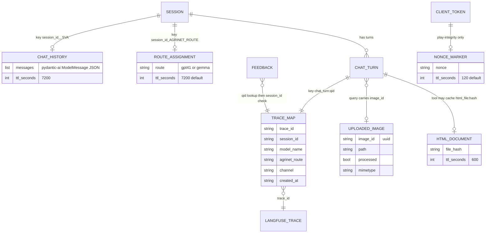

# Database and Data Stores

Related pages: [Caching](../integrations/caching.md) | [Backend](backend.md) | [Third-party integrations](../integrations/third-party-integrations.md) | [AI/LLM](../integrations/ai-llm.md) | [Configuration](../architecture/configuration.md) | [Component diagram](../architecture/component-diagram.md)

> **Note:** This service does not own a relational (SQL) database. There are no ORM models, migrations, schema files or database drivers in the repository (a search for SQLAlchemy, psycopg, asyncpg, Alembic, SQLite, MongoDB and Django-style models found none; the only hit is a stale comment in `app/core/cache.py`). Persistent business data (documents, schemes, catalogs) is held by external systems, and the API's own state is limited to Redis keys and short-lived files on local disk, documented below. Because there are no tables, no entity-relationship diagram of a SQL schema exists; the diagram in [section 6](#6-logical-data-relationships) shows how the Redis keys relate to each other.

---

## 1. Data Store Inventory

| Store | Type | Owned by this service? | Used for | Access code |
|-------|------|------------------------|----------|-------------|
| Redis | Key-value cache (db `REDIS_DB`, default 0) | Shared instance; this service writes its own prefixed keys | Chat history, model-route stickiness, qid-to-trace map, tokens/nonces, HTML documents, metrics cache; also read-only access to a master-catalog snapshot written by another system | `app/core/cache.py` (aiocache), `app/utils.py`, `helpers/master_catalog.py` (raw `redis.Redis`) |
| Local disk (`TEMP_UPLOAD_DIR`) | Filesystem (+ JSON sidecar files) | Yes | Temporary crop images awaiting NPSS analysis | `app/core/image_storage.py` |
| Optional mounted bucket (`GCS_MOUNT_PATH`) | Filesystem mount (a GCS bucket mounted by the platform) | No (platform-provided) | Optional archive of processed images | `app/core/image_storage.py` (`cleanup_image(..., move_to_gcs=True)`) |
| Qdrant | Vector database | No (external) | Video transcripts searched by the `search_video` tool (`QDRANT_VIDEO_COLLECTION_NAME`, default `video_data_collection`); a scheme-document collection (`QDRANT_COLLECTION_NAME`, default `schemes-index`) is supported by helper code but see the note in section 3 | `helpers/scheme_qdrant_search.py`, `helpers/video_qdrant_search.py`, `agents/tools/search.py` |
| Marqo | Vector search service | No (external) | Document and pest/disease knowledge search (`MARQO_ENDPOINT_URL`, `MARQO_INDEX_NAME` default `sunbird-va-index`, `MARQO_PESTS_DISEASES_INDEX_NAME`) | `agents/tools/search.py` |
| Prompt and reference files | Static files in the repo | Yes (read-only at runtime) | `assets/prompts/*.md`, `assets/*.json` (commodity codes, glossary terms, grievance types) | `helpers/utils.py` (`get_prompt`, `load_json_data`) |

> **Note:** `app/config.py` declares AWS settings (`aws_access_key_id`, `aws_secret_access_key`, `aws_region`, `aws_s3_bucket`) and `helpers/utils.py` imports `boto3`, but no code path reads or writes S3 objects today. Uploaded images are kept on local disk, not in S3. Object-storage usage is therefore not part of the current implementation.

---

## 2. Redis Key Catalog

All keys written through `app/core/cache.py` get the prefix `REDIS_KEY_PREFIX` (default `sva-cache-`). With an aiocache namespace the key is `<prefix><namespace>:<key>`. Values are JSON-serialized (`JsonSerializer`). Default TTL when none is supplied to `cache.set`: `settings.default_cache_ttl` (24 h); `app/utils.py:set_cache` always passes an explicit TTL (default 2 h). TTL and invalidation details are in [caching.md](../integrations/caching.md).

| Logical key (before prefix) | Structure / value | TTL | Writer | Reader |
|-----------------------------|-------------------|-----|--------|--------|
| `<session_id>__SVA` | JSON list: pydantic-ai `ModelMessage` history (`to_jsonable_python`) | 2 h (`DEFAULT_CACHE_TTL`), reset every turn | `update_message_history` (`app/utils.py`), called by `_finalize_chat_turn` in `app/services/chat.py` | `_get_message_history` (chat routers) |
| `<session_id>__SVA_MODERATION` | JSON list of moderation messages | 2 h | `update_moderation_history` (`app/utils.py`) | `_get_moderation_history` |
| `<session_id>_AGRINET_ROUTE` | string `"gpt41"` or `"gemma"` | `AGRINET_ROUTE_TTL_SECONDS` (default 7200 s), refreshed at the end of each turn | `app/services/agrinet_routing.py` | same |
| `gemma_concurrency` | integer (running + waiting requests on the Gemma vLLM engine) | `AGRINET_GEMMA_METRICS_CACHE_TTL` (default 2 s) | `get_gemma_concurrency` | same |
| `chat_turn:<qid>` | JSON object: `trace_id`, `session_id`, `model_name`, `agrinet_route`, `channel`, `created_at` | 2 h | `write_chat_turn_map` (`app/services/chat_turn_map.py`) | `read_chat_turn_map`, used by `POST /api/telemetry/feedback` |
| `integrity_nonce:<nonce>` | boolean `true` | `PLAY_INTEGRITY_FRESHNESS_SECONDS` (default 120 s) | `_ensure_nonce_not_reused` (`app/routers/token.py`) | same (replay guard) |
| `html_file:<file_hash>` | string: full HTML document | 10 min (`FILE_TTL` in `agents/tools/shc_scheme_status.py`) | `cache_and_update_url` in the SHC status tool | `GET /api/file/{file_hash}` (`app/routers/file.py`) |
| `npss:bearer_token` | string: NPSS API bearer token | 25 min (`NPSS_TOKEN_TTL_SECONDS`) | `_get_cached_npss_token` (`agents/tools/npss.py`) | same; deleted on auth failure (`cache.delete`) |
| `sathi:crop_groups` (namespace `sathi`) | JSON list of crop-group records | 7 days | `get_sathi_crop_groups` (`agents/tools/sathi_seed.py`) | same |
| `health_check_test` | string `"test"` | 5 s | `check_cache_connection` (`app/routers/health.py`) | same |

### Unprefixed key read by this service

| Key | Structure | Writer | Reader |
|-----|-----------|--------|--------|
| `master-catalog:<tier>:snapshot` (`<tier>` = `dev` when `ENVIRONMENT` is local/dev/development, else `live`; overridden by `MASTER_CATALOG_REDIS_KEY` when set) | Raw JSON dict with `version`, `updated_at`, `entries` (list) | Written by an external document pipeline ("docs-pipeline"); not written by this service | `helpers/master_catalog.py:get_master_catalog_snapshot` through a synchronous `redis.Redis` client; fails open (returns `None`) on any error |

> **Note:** The master catalog is produced by a separate system and is read here only. Its schema and publication process are managed outside this service.

---

## 3. Qdrant Collections

| Collection (env var, default) | Point payload fields used by the code | Filters | Used by |
|-------------------------------|----------------------------------------|---------|---------|
| Scheme index (`QDRANT_COLLECTION_NAME`, `schemes-index`) | `type` (must equal `scheme`), `scheme_code`, `scheme_name`, `text`, `doc_id`, `chunk_id` | `type = "scheme"`, optional `scheme_code` | `helpers/scheme_qdrant_search.py` (`search_schemes`, `_run_scheme_search`, `_hit_to_result`). Embeddings: `intfloat/multilingual-e5-large` (SentenceTransformer, pre-downloaded in the `Dockerfile`, pre-warmed in `lifespan`) |
| Video index (`QDRANT_VIDEO_COLLECTION_NAME`, `video_data_collection`) | `type = "video"`, `name`, `source` (documented in `helpers/video_qdrant_search.py`) | `type = "video"` | `search_video` tool (`agents/tools/search.py`) |

Connection: `QDRANT_URL` (default `http://localhost:6333` in the client helper) and `QDRANT_API_KEY`; a key is mandatory for non-local hosts (`get_qdrant_client`). Collection provisioning and ingestion are not part of this repository.

> **Note:** The agent-facing `search_schemes` tool (`agents/tools/search.py`) queries scheme documents through the Vistaar network layer (category `scheme-agri-qdrant`), not directly through the Qdrant helper; the helper function `helpers/scheme_qdrant_search.py:search_schemes` has no caller in the repository, while the shared embedder/Qdrant client are used for video search and startup warm-up.

> **Note:** Qdrant and Marqo indexes are populated by external ingestion pipelines. This wiki documents only the fields the API reads. Index creation, re-indexing and backup are managed outside this service.

---

## 4. Image Storage (Local Disk)

Implemented in `app/core/image_storage.py`.

| Aspect | Behaviour |
|--------|-----------|
| Location | `TEMP_UPLOAD_DIR` (env, default `<repo>/.oan-uploads`) |
| File naming | `<uuid>.<ext>` where ext is `.jpg`, `.png`, `.webp` or `.bin` (from the upload content type) |
| Sidecar metadata | `<uuid>.json` with `path`, `created_at` (ISO 8601 UTC), `mimetype`, `original_name`, `processed` |
| In-memory registry | `_upload_registry` dict (per process); the disk sidecar and filename scan are the fallback, so any uvicorn worker on the same filesystem can serve an upload |
| Size limit | `MAX_IMAGE_UPLOAD_SIZE_MB` (default 10 MB), enforced while reading 1 MB chunks (HTTP 413) |
| Path safety | UUID normalization via `_normalize_image_id`, `_safe_child_path` (resolves and verifies path stays inside the base dir), allowed-root check when loading metadata |
| Lifecycle | `mark_processed(image_id)` when the NPSS tool starts analysis; `cleanup_image(image_id, move_to_gcs=GCS_MOVE_AFTER_PROCESS)` after a successful NPSS call (deletes the file and sidecar, or moves the file to `GCS_MOUNT_PATH` when `GCS_MOVE_AFTER_PROCESS` is truthy and the mount is configured); both are called from `agents/tools/npss.py` |
| Expiry | `cleanup_expired_images()` removes processed images older than `IMAGE_TTL_MINUTES` (default 60), but it has no caller in the repository |
| Public URL | `BASE_URL` + `/api/image/<uuid>` (relative path when `BASE_URL` is empty) |

> **Note:** Images that are uploaded but never analyzed are not removed by any scheduled job in this repository, and `GET /api/image/{image_id}` does not check the TTL. Retention and disk-space management for the upload directory (and the optional bucket mount) are managed by the hosting environment. In multi-replica deployments the upload directory must be shared storage for the NPSS tool's download call to succeed on any replica.

---

## 5. Conversation Data Model (stored in Redis)

The chat history stored under `<session_id>__SVA` is the pydantic-ai message list serialized with `ModelMessagesTypeAdapter`. Typical content: `ModelRequest` (system prompt part, user-prompt part, tool-return parts) and `ModelResponse` (text, tool-call parts, usage). Before storing, `filter_thinking_from_history` removes thinking parts and `_replace_last_text_output` replaces the final text with exactly what the farmer received. Before each model call history is trimmed (`trim_history`, 64,000 token budget, always keeping the first exchange).

---

## 6. Logical Data Relationships

This diagram shows how the Redis entities relate through identifiers (it is a logical view of keys, not a SQL schema).

---

## 7. Backup, Migration and Retention

> **Note:** Backup, persistence (RDB/AOF) and eviction settings for Redis, and snapshotting for Qdrant/Marqo, are managed outside this application and are not documented in this wiki. All Redis keys written by the API carry a TTL (maximum 7 days for the SATHI crop-group cache), so the data is treated as disposable. Database migrations do not apply because there is no relational schema. See [disaster-recovery](../operations/disaster-recovery.md) and [infrastructure](../operations/infrastructure.md).

---

## Source Files

`app/core/cache.py`, `app/utils.py`, `app/config.py`, `app/core/image_storage.py`, `app/services/agrinet_routing.py`, `app/services/chat_turn_map.py`, `app/routers/token.py`, `app/routers/file.py`, `app/routers/health.py`, `app/routers/image.py`, `agents/tools/npss.py`, `agents/tools/sathi_seed.py`, `agents/tools/shc_scheme_status.py`, `agents/tools/search.py`, `helpers/master_catalog.py`, `helpers/scheme_qdrant_search.py`, `helpers/video_qdrant_search.py`, `Dockerfile`.
