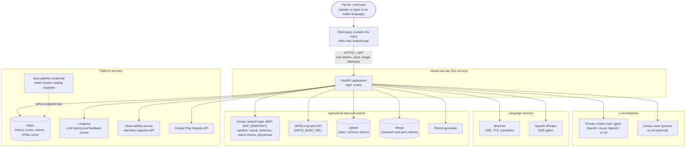
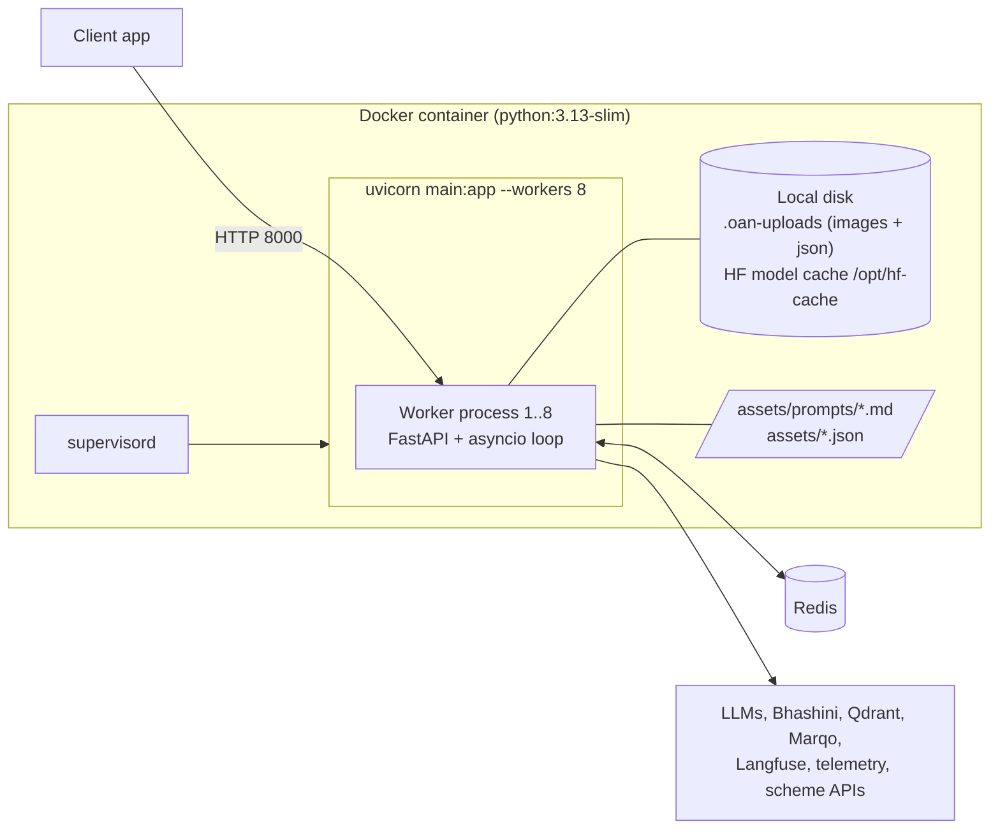

# Component Diagrams

This page is the canonical home for the **system context** and **internal component** diagrams of `bharat-oan-api`. Request/response sequences and workflow flowcharts are kept in [sequence-diagrams.md](sequence-diagrams.md); deployment topology belongs in [operations/deployment.md](../operations/deployment.md) and [operations/infrastructure.md](../operations/infrastructure.md).

Related pages: [Architecture overview](architecture-overview.md) | [Backend](../application/backend.md) | [API specification](../application/api-specification.md) | [Database / data stores](../application/database.md) | [AI/LLM](../integrations/ai-llm.md) | [Third-party integrations](../integrations/third-party-integrations.md) | [Caching](../integrations/caching.md) | [Async processing](../integrations/async-processing.md)

---

## 1. System Context (C4 Level 1)

The API sits between farmer-facing client applications (not part of this repository) and a set of AI model endpoints, speech/translation providers, government data services and observability back-ends.

Legend: solid arrows are runtime calls made by the service; the dotted arrow is data written by an external system that the service only reads. Tool-to-endpoint details are in [third-party-integrations.md](../integrations/third-party-integrations.md); model/provider choices in [ai-llm.md](../integrations/ai-llm.md).

> **Note:** ElevenLabs (`eleven_labs_api_key` in `app/config.py`, `service_type='eleven_labs'` in `TTSRequest`) is accepted in configuration and the request model, but the TTS handler only serves Bhashini, so it is not shown as a live dependency. AWS S3 settings exist in `app/config.py` but no S3 calls are made.

---

## 2. Container View (C4 Level 2)

One deployable container (a Docker image) runs several uvicorn worker processes under `supervisord`. Redis, Qdrant, Marqo and the LLM endpoints are separate services.

Per-worker in-memory state (not shared): upload registry, Play Integrity credential cache, detached finalizer task set, embedder/Qdrant client caches ([backend.md](../application/backend.md#8-concurrency-and-process-model)).

---

## 3. Internal Component Diagram (C4 Level 3)

```mermaid
flowchart TB
    subgraph entry["Entry point (main.py)"]
        app["FastAPI app + lifespan"]
        cors["CORSMiddleware"]
        timing["TimingAllowOriginMiddleware"]
    end

    subgraph routers["HTTP layer (app/routers)"]
        r_chat["chat.py<br/>GET /chat/, POST /chat/analyze-image"]
        r_tr["transcribe.py"]
        r_tts["tts.py"]
        r_img["image.py"]
        r_file["file.py"]
        r_tok["token.py"]
        r_tel["telemetry.py"]
        r_health["health.py"]
        r_cq["chat_query_utils.py"]
    end

    subgraph auth["Auth (app/auth)"]
        jwt["jwt_auth.get_current_user<br/>RS256 public key"]
    end

    subgraph services["Services (app/services)"]
        chat["chat.py<br/>stream_chat_messages<br/>failover, finalizer"]
        route["agrinet_routing.py<br/>weighted route + capacity gate"]
        turnmap["chat_turn_map.py"]
        npssresp["npss_response.py"]
    end

    subgraph core["Core (app/core)"]
        cache["cache.py<br/>aiocache Redis"]
        imgstore["image_storage.py"]
        npssfu["npss_followup.py"]
        geo["npss_geocodes.py"]
    end

    subgraph tasks["Tasks (app/tasks)"]
        t_tel["telemetry.send_telemetry"]
        t_sug["suggestions.py (disabled)"]
    end

    util["app/utils.py<br/>history, trim, cache wrappers"]
    cfg["app/config.py<br/>Settings"]

    subgraph agents["Agents (agents/)"]
        mod["moderation_agent"]
        main_agent["agrinet_agent<br/>+ TOOLS"]
        models["models.py<br/>route to model"]
        deps["deps.FarmerContext"]
        tools["tools/*<br/>scheme, weather, mandi,<br/>search, npss, grievance..."]
    end

    subgraph helpers["Helpers (helpers/)"]
        h_tel["telemetry.py<br/>event builders"]
        h_lf["langfuse_*.py"]
        h_tts["tts.py / transcription.py /<br/>translation.py (Bhashini)"]
        h_q["scheme_qdrant_search.py /<br/>video_qdrant_search.py"]
        h_mc["master_catalog.py"]
        h_utils["utils.py<br/>get_prompt"]
    end

    app --> cors --> timing
    app --> routers
    r_chat --> jwt
    r_tr --> jwt
    r_tts --> jwt
    r_img --> jwt
    r_tel --> jwt
    r_chat --> r_cq
    r_cq --> imgstore
    r_cq --> util
    r_img --> imgstore
    r_file --> cache
    r_health --> cache
    r_tok --> cache

    r_chat --> chat
    chat --> route
    chat --> turnmap
    chat --> npssresp
    chat --> npssfu
    chat --> mod
    chat --> main_agent
    chat --> util
    chat --> t_tel
    chat --> h_tel
    chat --> h_lf
    route --> models
    route --> util
    turnmap --> util
    util --> cache
    main_agent --> tools
    main_agent --> deps
    main_agent --> models
    main_agent --> h_utils
    tools --> imgstore
    tools --> cache
    tools --> geo
    tools --> h_q
    main_agent --> h_mc
    npssresp --> h_tts

    r_tr --> h_tts
    r_tts --> h_tts
    r_tr --> t_tel
    r_tts --> t_tel
    r_tel --> t_tel
    r_tel --> turnmap
    r_tel --> h_lf
    t_tel --> cfg
    cache --> cfg
```

### Component responsibilities

| Component | Responsibility | Primary files |
|-----------|----------------|---------------|
| Entry point | App creation, middleware, lifespan validation, router mounting | `main.py` |
| Routers | HTTP contract and auth dependency per feature | `app/routers/*.py` ([API spec](../application/api-specification.md)) |
| Auth | Verify RS256 bearer tokens; issuance in `token.py` | `app/auth/jwt_auth.py`, `app/routers/token.py` |
| Chat service | Orchestrate moderation, agent run, streaming, failover, disconnect finalization, history saving, telemetry | `app/services/chat.py` |
| Model routing | Per-session `gpt41` / `gemma` choice with Redis stickiness and a Gemma capacity gate | `app/services/agrinet_routing.py`, `agents/models.py` |
| Agents and tools | pydantic-ai agent (`agrinet_agent`), moderation agent, tool registry (`agents/tools/__init__.py:TOOLS`) | `agents/` ([AI/LLM](../integrations/ai-llm.md)) |
| Cache and state | Redis access, history persistence and trimming | `app/core/cache.py`, `app/utils.py` ([caching](../integrations/caching.md)) |
| Image storage | Temporary upload storage, metadata, cleanup | `app/core/image_storage.py` |
| NPSS post-processing | Deterministic attribution/translation of crop-diagnosis output | `app/services/npss_response.py`, `app/core/npss_followup.py` |
| Telemetry | Event builders (`helpers/telemetry.py`) and delivery (`app/tasks/telemetry.py`) | [async-processing](../integrations/async-processing.md) |
| Observability | Langfuse spans/scores for each chat turn and user feedback | `helpers/langfuse_*.py`, `app/services/chat_turn_map.py` |

---

## 4. Chat Turn Component Collaboration

The components that cooperate for a chat turn are the Chat service, Moderation agent, Agrinet agent with tools, Redis (history and route), telemetry task and Langfuse. The time-ordered view is the canonical sequence [W2](sequence-diagrams.md#w2-streaming-chat-turn); this page intentionally does not repeat it.

---

## Source Files

`main.py`, `app/routers/*.py`, `app/auth/jwt_auth.py`, `app/services/*.py`, `app/core/*.py`, `app/tasks/*.py`, `app/utils.py`, `app/config.py`, `agents/agrinet.py`, `agents/models.py`, `agents/deps.py`, `agents/moderation.py`, `agents/tools/__init__.py`, `helpers/*.py`, `Dockerfile`, `supervisord.conf`.
