# Sequence and Workflow Diagrams

This is the **single canonical file** for request/response sequences and workflow flowcharts of `bharat-oan-api`. Other pages link here instead of repeating the diagrams. Component and system-context views are in [component-diagram.md](component-diagram.md); the narrative of each workflow is in [../business/workflows.md](../business/workflows.md).

Related pages: [API specification](../application/api-specification.md) | [Backend](../application/backend.md) | [Caching](../integrations/caching.md) | [Async processing](../integrations/async-processing.md) | [AI/LLM](../integrations/ai-llm.md) | [Architecture overview](architecture-overview.md)

All diagrams were derived from the source files cited under each heading (status: **Implemented, verified**) unless explicitly labelled otherwise.

## Diagram Index

| ID | Diagram | Type | Primary source |
|----|---------|------|----------------|
| [W1](#w1-authentication-and-token-issuance) | Authentication and token issuance (guest, API key, Play Integrity) and token use | Sequence | `app/routers/token.py`, `app/auth/jwt_auth.py` |
| [W2](#w2-streaming-chat-turn) | Streaming chat turn (including disconnect handling) | Sequence | `app/routers/chat.py`, `app/services/chat.py` |
| [W3](#w3-crop-image-upload-and-analysis) | Crop image upload and NPSS analysis (and the location follow-up) | Sequence + flowchart | `app/routers/image.py`, `app/routers/chat_query_utils.py`, `agents/tools/npss.py` |
| [W4](#w4-voice-transcription-asr) | Voice transcription (ASR) | Sequence | `app/routers/transcribe.py` |
| [W5](#w5-text-to-speech-tts) | Text-to-speech | Sequence | `app/routers/tts.py` |
| [W6](#w6-telemetry-and-feedback) | Telemetry and user feedback | Sequence | `app/routers/telemetry.py`, `app/tasks/telemetry.py` |
| [W7](#w7-conversation-suggestions-disabled) | Conversation suggestions (disabled in the running app) | Sequence | `app/tasks/suggestions.py`, `app/routers/suggestions.py` |
| [W8](#w8-model-routing-and-failover) | Model routing, capacity gate and failover | Flowchart | `app/services/agrinet_routing.py`, `app/services/chat.py` |
| [W9](#w9-cached-html-document-serving) | Cached HTML document serving | Sequence | `app/routers/file.py`, `agents/tools/shc_scheme_status.py` |
| [W10](#w10-health-probes) | Health, liveness and readiness probes | Sequence | `app/routers/health.py` |
| [F1](#f1-chat-request-lifecycle-and-error-paths) | Chat request lifecycle and error paths | Flowchart | `app/services/chat.py` |
| [F2](#f2-service-startup) | Service startup | Flowchart | `main.py` |

> **Note:** The workflow IDs W1-W10 above are the identifiers used by the technical pages of this wiki. The business-facing catalogue in [workflows.md](../business/workflows.md) describes the same flows in prose; if its numbering differs, match by title.

---

## W1 Authentication and token issuance

Source: `app/routers/token.py` (`create_auth_token`, `create_auth_token_with_api_key`, `create_auth_token_with_play_integrity`), `app/auth/jwt_auth.py` (`get_current_user`). Endpoints: `POST /api/token`, `POST /api/token/api-key`, `POST /api/token/play-integrity`.

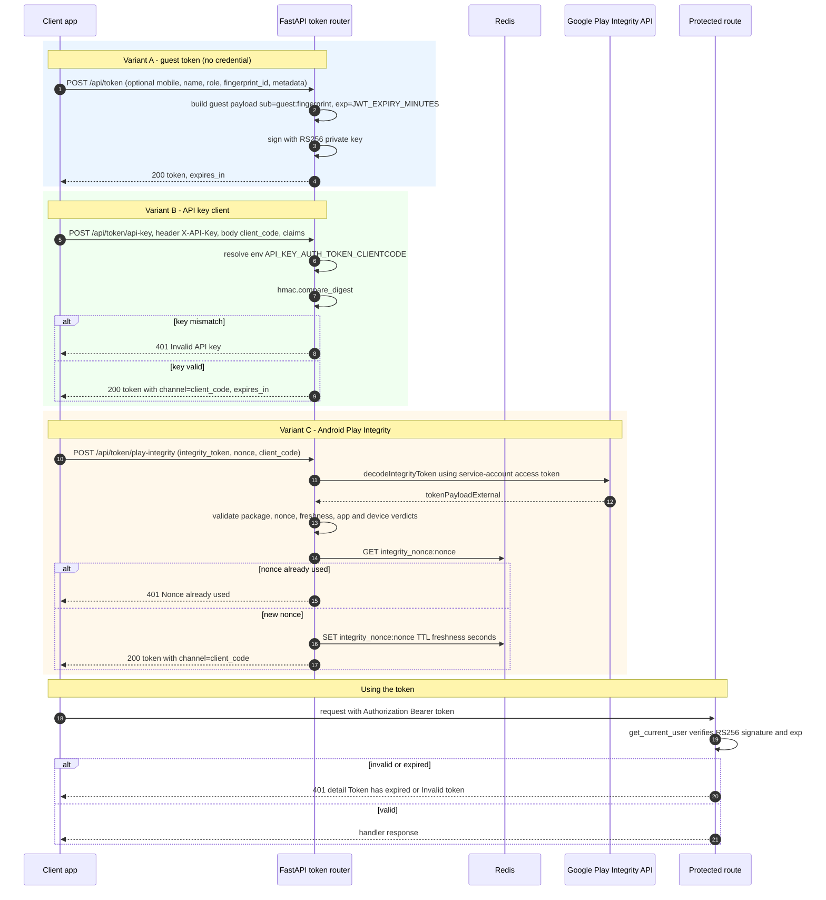

Notes: the guest variant requires no credential by design. The nonce check is get-then-set (not atomic). Error codes per variant are listed in [api-specification.md](../application/api-specification.md#4-response-models-and-status-codes).

---

## W2 Streaming chat turn

Source: `app/routers/chat.py:chat_endpoint`, `app/routers/chat_query_utils.py`, `app/services/chat.py:stream_chat_messages`, `app/services/agrinet_routing.py`, `app/utils.py`. Endpoint: `GET /api/chat/`.

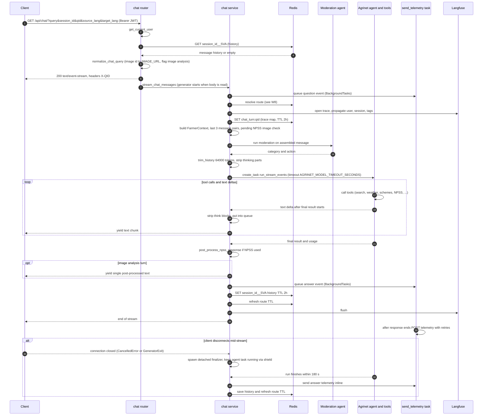

Key behaviours: the response headers are returned before moderation or model work begins; text deltas are forwarded only after the model signals its final result part (the flag resets after every tool result); chunks are raw text (not SSE `data:` frames); the detached finalizer exists because response background tasks do not run after a disconnect. Contract: [api-specification.md](../application/api-specification.md#5-chat-streaming-contract). Error and failover paths: [F1](#f1-chat-request-lifecycle-and-error-paths) and [W8](#w8-model-routing-and-failover).

---

## W3 Crop image upload and analysis

Source: `app/routers/image.py` (`upload_image`, `serve_image`), `app/core/image_storage.py`, `app/routers/chat_query_utils.py`, `app/services/chat.py` (`_wrap_image_analysis_message`), `agents/tools/npss.py` (`analyze_crop_image`), `app/core/npss_followup.py`. Endpoints: `POST /api/image/upload`, `GET /api/chat/`, `GET /api/image/{image_id}`. The deprecated `POST /api/chat/analyze-image` performs the upload and the chat turn in one request.

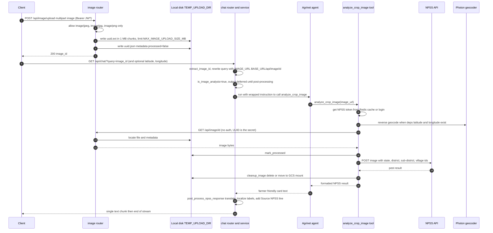

### Location follow-up and fallback (flowchart)

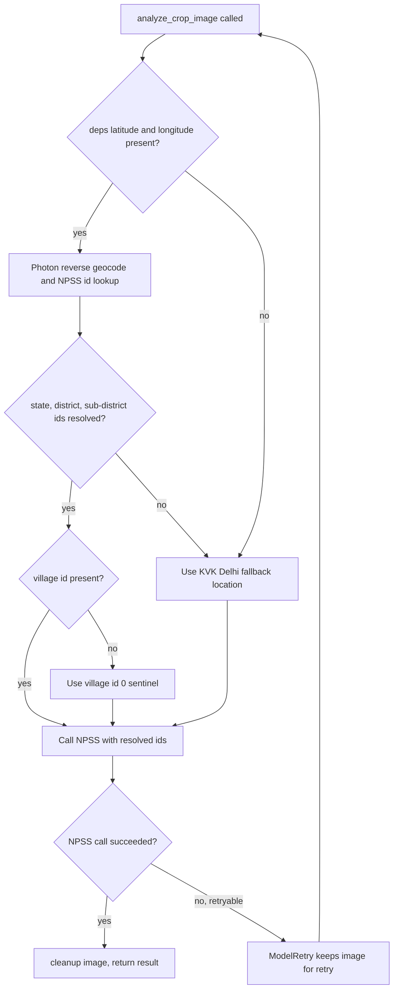

> **Note:** In `app/services/chat.py` the browser `latitude` and `longitude` are used only inside the instruction text sent to the model. `FarmerContext` is created without those values, and `agents/tools/npss.py` reads `deps.latitude` / `deps.longitude`, so the "location present" branch cannot currently be taken from a chat request. This is recorded as technical debt in [technical-debt.md](../knowledge/technical-debt.md).

Details of the follow-up detection (`find_pending_npss_image_url`) and storage lifecycle: [backend.md](../application/backend.md#65-support-modules) and [database.md](../application/database.md#4-image-storage-local-disk).

---

## W4 Voice transcription (ASR)

Source: `app/routers/transcribe.py:transcribe`, `helpers/transcription.py`, `helpers/telemetry.py:create_asr_event`. Endpoint: `POST /api/transcribe/`.

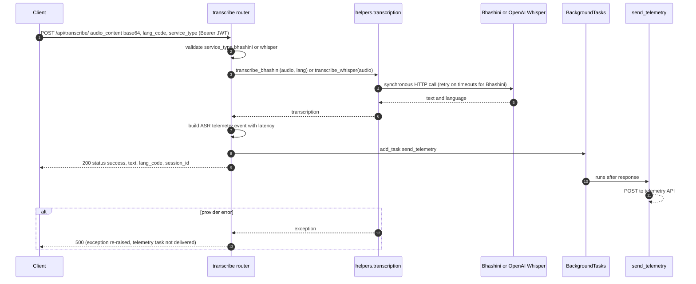

---

## W5 Text-to-speech (TTS)

Source: `app/routers/tts.py:tts`, `helpers/tts.py:text_to_speech_bhashini`, `helpers/telemetry.py:create_tts_event`. Endpoint: `POST /api/tts/`.

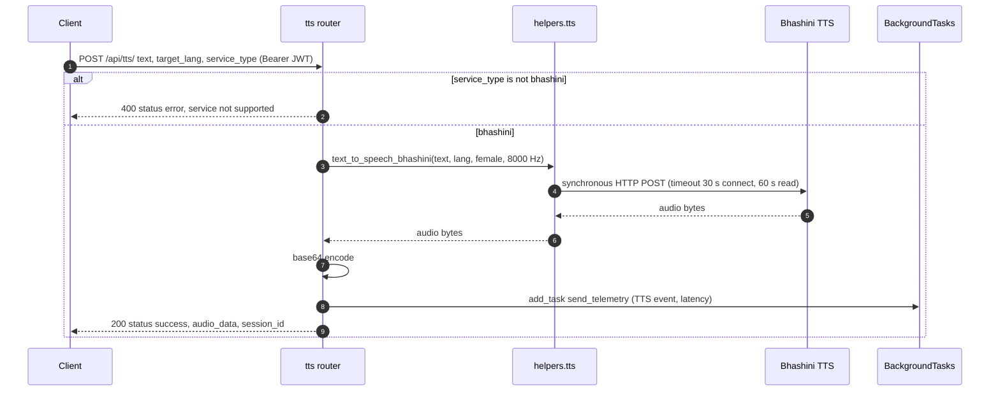

---

## W6 Telemetry and feedback

Source: `app/routers/telemetry.py`, `app/tasks/telemetry.py`, `helpers/telemetry.py`, `helpers/langfuse_scores.py`, `app/services/chat_turn_map.py`. Endpoints: `POST /api/telemetry/feedback`, `/events`, `/error`; backend-originated chat events inside W2, W4, W5.

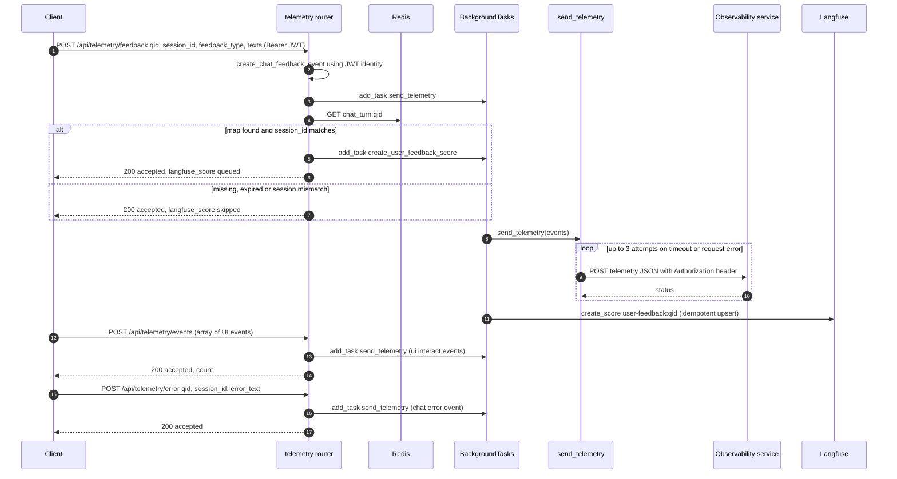

---

## W7 Conversation suggestions (disabled)

Status: **not active in the running application.** `main.py` has the router import and `include_router` commented out, `app/tasks/__init__.py` has the `create_suggestions` import commented out, and the chat service does not schedule the task. The diagram documents the intended design found in `app/tasks/suggestions.py` and `app/routers/suggestions.py`.

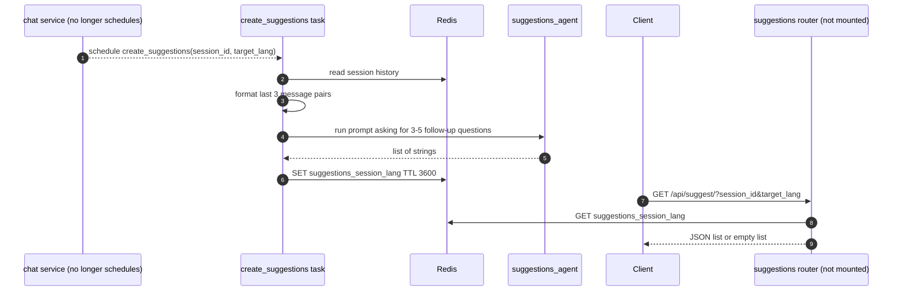

> **Note:** This flow is retained in code for reference. Reviving it would require fixing the stale references noted in [async-processing.md](../integrations/async-processing.md#4-task-modules-present-but-not-active).

---

## W8 Model routing and failover

Source: `app/services/agrinet_routing.py` (`resolve_agrinet_route`, `_apply_capacity_gate`, `get_gemma_concurrency`), `app/services/chat.py` (`_run_agrinet_with_failover_streaming`), `agents/models.py`. Applies to every chat turn ([W2](#w2-streaming-chat-turn)).

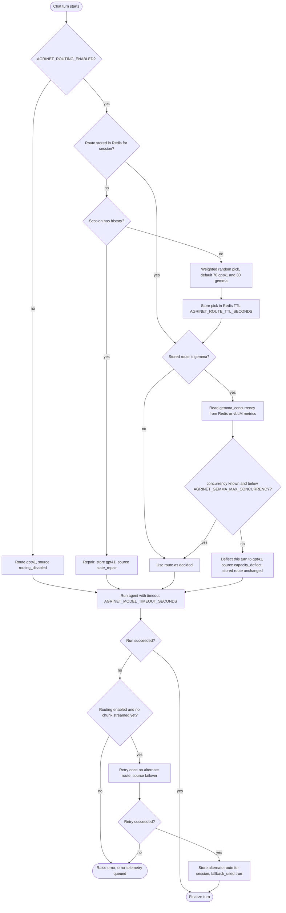

---

## W9 Cached HTML document serving

Source: `agents/tools/shc_scheme_status.py` (`cache_and_update_url`, `FILE_TTL = 600`), `app/routers/file.py`. Endpoint: `GET /api/file/{file_hash}`.

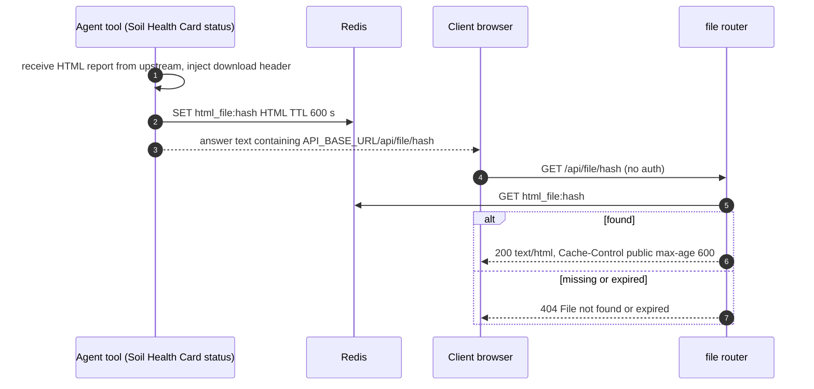

---

## W10 Health probes

Source: `app/routers/health.py`. Endpoints: `GET /api/health/`, `/api/health/live`, `/api/health/ready`.

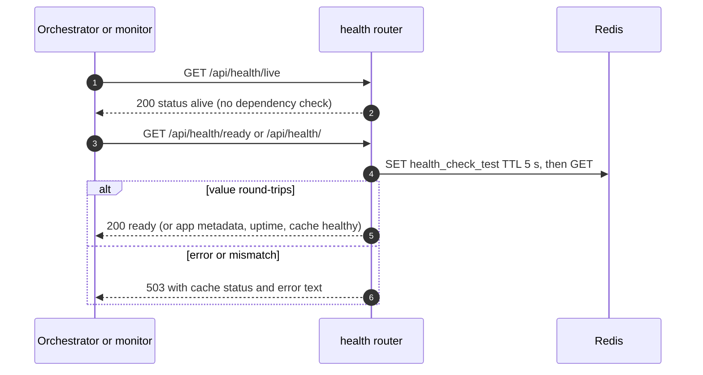

---

## F1 Chat request lifecycle and error paths

Workflow flowchart for `stream_chat_messages` showing success, failure and disconnect outcomes (companion to the sequence in [W2](#w2-streaming-chat-turn)).

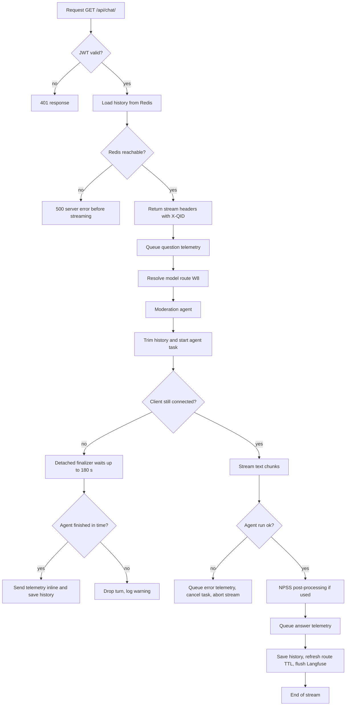

---

## F2 Service startup

Source: `main.py` (`lifespan`), module import side effects in `app/auth/jwt_auth.py`, `app/routers/token.py`, `agents/models.py`, `app/core/image_storage.py`.

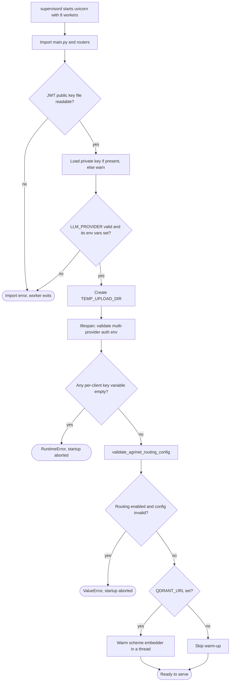

---

## Source Files

`app/routers/*.py`, `app/auth/jwt_auth.py`, `app/services/chat.py`, `app/services/agrinet_routing.py`, `app/services/chat_turn_map.py`, `app/core/image_storage.py`, `app/tasks/*.py`, `agents/tools/npss.py`, `agents/tools/shc_scheme_status.py`, `helpers/telemetry.py`, `helpers/transcription.py`, `helpers/tts.py`, `helpers/langfuse_scores.py`, `main.py`.
