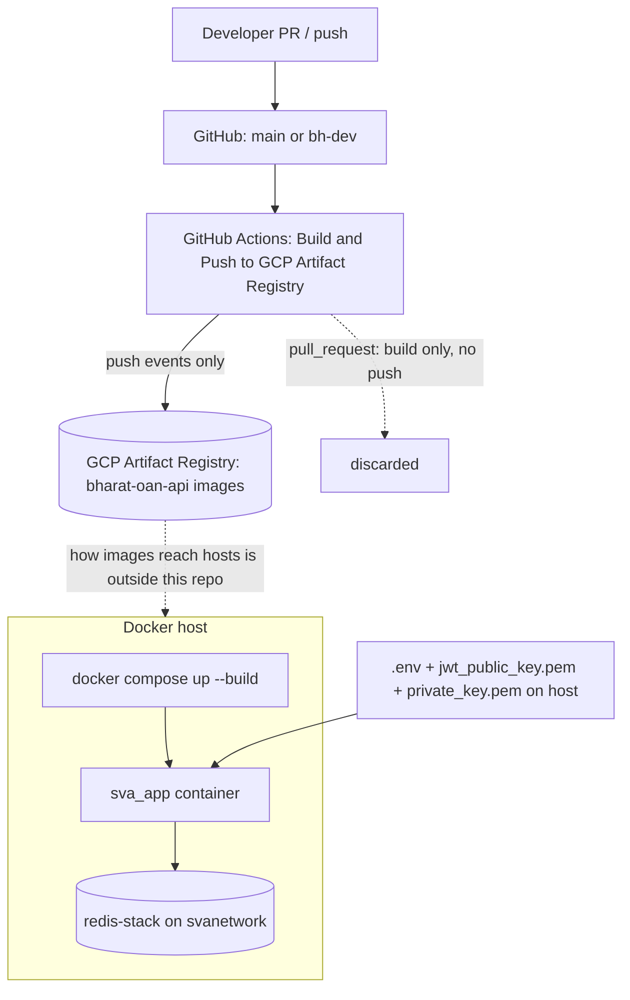

# Deployment

Build, run and release procedures for `bharat-oan-api`, based on `Dockerfile`, `docker-compose.yml`, `README.md`, `docs/setup/*.md` and `.github/workflows/build.yml`.

Related: [Infrastructure](infrastructure.md) | [Monitoring](monitoring.md) | [Troubleshooting](troubleshooting.md) | [Disaster Recovery](disaster-recovery.md) | [Configuration](../architecture/configuration.md) | [Repository Conventions](../architecture/repository-conventions.md)

## Deployment topology



Dotted edges are not defined in the repository. Service-level topology (Redis, Qdrant, LLMs, external APIs) is on [Infrastructure](infrastructure.md).

> **Note:** The repository contains a CI workflow that builds and publishes images, but no automated deployment step. How an image from Artifact Registry (or a fresh `docker compose` build) is rolled out to servers, and the production load balancer, Kubernetes or multi-region layout, are managed outside this repository and are not documented in this wiki.

## CI: `.github/workflows/build.yml` (Implemented, verified)

| Aspect | Detail |
|--------|--------|
| Name | "Build and Push to GCP Artifact Registry" |
| Triggers | `push` and `pull_request` on branches `main` and `bh-dev` |
| Runner | `ubuntu-latest` |
| Environment | `${{ github.base_ref || github.ref_name }}`, so a GitHub Environment named `main` or `bh-dev` must exist |
| Auth | `google-github-actions/auth@v2` with secret `GCP_SA_KEY`, then `setup-gcloud@v2`, then `gcloud auth configure-docker ${{ secrets.GCP_REGION }}-docker.pkg.dev` |
| Secrets used | `GCP_SA_KEY`, `GCP_REGION`, `GCP_PROJECT_ID`, `GCP_ARTIFACT_REPO` |
| Build | `docker/build-push-action@v5`, `context: .`, `push: false`, `load: true`, `platforms: linux/amd64`, GitHub Actions cache (`cache-from/to: type=gha,mode=max`) |
| Image name | `bharat-oan-api` |
| Tags | `<BUILD_TAG>-latest`, `<BUILD_TAG>`, `<SIMPLE_TAG>`, and the commit SHA, under `<region>-docker.pkg.dev/<project>/<repo>/bharat-oan-api` |
| Tag derivation | Branch name with `/` replaced by `-` is `BUILD_TAG`; `SIMPLE_TAG` is the part after the last `-` (`bh-dev` becomes `dev`, `main` stays `main`) |
| Push | Only when `github.event_name == 'push'` (four `docker push` commands). Pull requests build the image but do not publish it |
| Build args | None passed; `HF_TOKEN` therefore stays empty in CI builds |
| Not in the workflow | Tests, linting, security scans, deployment, notifications |

For `main` the `BUILD_TAG` and `SIMPLE_TAG` are both `main`, so the same tag is pushed twice.

## Build and run (manual, documented)

Sources: `README.md`, `docker-compose.yml`, `docs/setup/redis.md`.

1. **Prepare the host.** Docker installed; create the shared network and start Redis as in `docs/setup/redis.md`:
   ```bash
   docker network create svanetwork
   # then run redis/redis-stack on svanetwork as shown in docs/setup/redis.md
   ```
2. **Prepare the checkout.** Place `.env` (see [Configuration](../architecture/configuration.md); `REDIS_HOST` must be the Redis container name on `svanetwork`), `jwt_public_key.pem` (required at import), and `private_key.pem` (needed to issue tokens) next to `main.py`. These files are gitignored.
3. **Build and start:**
   ```bash
   docker compose up --build --force-recreate --detach
   ```
   Optionally pass `HF_TOKEN` in the shell so the build can authenticate to HuggingFace (compose forwards it as a build arg).
4. **Verify:**
   ```bash
   curl http://localhost:8000/api/health/live
   curl http://localhost:8000/api/health/ready   # 503 if Redis is unreachable
   ```
5. **Logs:** `docker logs -f sva_app` (the container name in `docker-compose.yml`; `README.md` shows `oan_app`, which does not match the compose file).
6. **Stop:** `docker compose down --remove-orphans`.
7. **Cleanup (destructive):** `docker system prune -a --volumes` is listed in `README.md` and removes all unused images and volumes on the host.

Startup behaviour (`main.py` lifespan): validates multi-provider auth variables and, if `AGRINET_ROUTING_ENABLED` is true, the routing configuration; prints environment and CORS origins; pre-warms the scheme embedder when `QDRANT_URL` is set. A missing `jwt_public_key.pem` or invalid `LLM_PROVIDER` aborts startup at import time.

## Python version and dependencies

- Base image is `python:3.13-slim` (PR #247, commit `2f9f19e`, "Upgrade API Docker base image to Python 3.13").
- `requirements.txt` is mostly unpinned (only `pydantic-ai==1.2.1`, `uvicorn[standard]==0.34.3`, `aiocache==0.12.3`, `pydantic-settings==2.9.1`, `langcodes[data]==3.4.0` and bounded `opentelemetry-api`/`Jinja2`); there is no lock file, so rebuilds can pick up newer dependency versions. A remote branch named `feat/locking_docker_dependencies_bh-main` suggests locking was explored elsewhere.
- Image builds are heavy: CPU-only `torch`, `sentence-transformers`, and a baked `intfloat/multilingual-e5-large` model, so first builds take longer and images are large.

## Portainer (optional, `docs/setup/portainer.md`)

The document lists commands to create a `portainer_data` volume, run `portainer/portainer-ce:2.21.2` on port `9443` with the Docker socket mounted, and connect the container to `svanetwork`.

> **Note:** `docs/setup/portainer.md` also contains an access URL and an administrator credential in clear text. They are intentionally not reproduced in this wiki. Treat that credential as exposed, rotate it, and move host access details to a private secrets store.

## Rollback

> **Note:** A rollback procedure is not documented in the repository. The service is stateless apart from Redis cache data (see [Disaster Recovery](disaster-recovery.md)), so returning to a previous version only requires running a previous image or commit.

Recommended (not yet implemented):

- Roll back by pulling and running an earlier image from Artifact Registry using its commit-SHA tag (the workflow publishes one per push), or by checking out the previous commit and re-running `docker compose up --build --force-recreate --detach`.
- Because compose bind-mounts `.:/app`, a rollback via compose also requires resetting the host checkout to the desired commit.
- Record the deployed SHA on the host (for example in the compose project label) so operators know what to return to.

## Release hygiene (observations)

- Environments are separated by branch (`main`, `bh-dev`), and Langfuse/master-catalog behaviour switches on `ENVIRONMENT` (`local`/`dev`/`development` use the `dev` catalog tier). See [Configuration](../architecture/configuration.md).
- No version tags or changelog are maintained (see [Repository Conventions](../architecture/repository-conventions.md)).
- No smoke test runs after deploy; use the health endpoints in [Monitoring](monitoring.md).

## Source Files

`.github/workflows/build.yml`, `Dockerfile`, `docker-compose.yml`, `supervisord.conf`, `README.md`, `docs/setup/portainer.md`, `docs/setup/redis.md`, `requirements.txt`, `main.py`.
