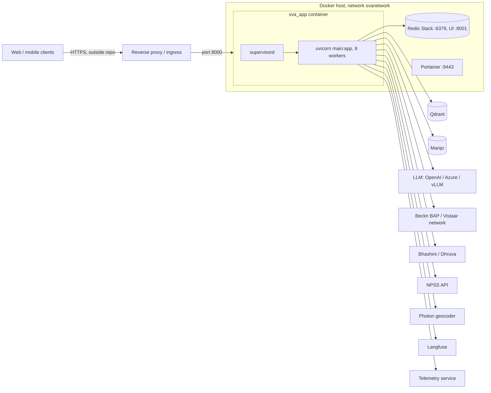

# Infrastructure

Runtime infrastructure of `bharat-oan-api` as evidenced by `Dockerfile`, `docker-compose.yml`, `supervisord.conf`, `docs/setup/*.md`, and the code that connects to external systems.

Related: [Deployment](deployment.md) | [Monitoring](monitoring.md) | [Disaster Recovery](disaster-recovery.md) | [Troubleshooting](troubleshooting.md) | [Configuration](../architecture/configuration.md) | [Caching](../integrations/caching.md) | [Third-party integrations](../integrations/third-party-integrations.md)

## Components

| Component | Evidence | Role |
|-----------|----------|------|
| API container `sva_app` | `docker-compose.yml` (`container_name: sva_app`, service `app`) | FastAPI app served by uvicorn under supervisord |
| Process manager | `supervisord.conf` | Program `fastapi`: `uvicorn main:app --host 0.0.0.0 --port 8000 --workers 8`, `autorestart=true`, `startsecs=5`, `startretries=3`, logs to stdout/stderr |
| Redis (Redis Stack) | `docs/setup/redis.md`, `app/core/cache.py`, `helpers/master_catalog.py` | Chat history, routing decisions, cached HTML files, SATHI/NPSS cache entries, master catalog snapshot (read) |
| Qdrant | `helpers/scheme_qdrant_search.py`, `helpers/video_qdrant_search.py`, `QDRANT_URL` | Vector search for scheme documents and videos |
| Marqo | `agents/tools/search.py`, `MARQO_*` | Vector search for documents and pests/diseases |
| LLM endpoints | `agents/models.py` | OpenAI, Azure OpenAI, or vLLM (optionally a Gemma vLLM route) |
| Network `svanetwork` | `docker-compose.yml` (`external: true`), `docs/setup/redis.md` | Shared Docker network joining the app, Redis and Portainer |
| Portainer | `docs/setup/portainer.md` | Optional container management UI joined to `svanetwork` |
| GCP Artifact Registry | `.github/workflows/build.yml` | Stores built images |
| Optional GCS mount | `GCS_MOUNT_PATH` in `app/core/image_storage.py` | Destination for processed crop images |

> **Note:** The repository provisions only the API container. Redis, Qdrant, Marqo, the LLM servers, the Beckn network participant (BAP endpoint), the reverse proxy / TLS terminator, DNS, and the host itself are managed outside this repository; `docs/setup/redis.md` and `docs/setup/portainer.md` document the Redis and Portainer host setup only. Production topology (load balancers, multi-region, Kubernetes) is not documented in this wiki.

## Topology (Implemented evidence, simplified)

The reverse proxy node is drawn because the compose file publishes port 8000 and the app trusts CORS configuration for browser clients; the proxy itself is not defined in the repository. Deployment-time flow is on [Deployment](deployment.md).

## Container image (`Dockerfile`)

| Step | Detail |
|------|--------|
| Base | `python:3.13-slim` (changed from an earlier version in PR #247 / commit `2f9f19e`) |
| System packages | `supervisor`, `gcc`, `python3-dev`, `curl` |
| Python deps | Upgrades pip/setuptools/wheel; installs CPU-only `torch` from `https://download.pytorch.org/whl/cpu`; installs `requirements.txt` minus `sentence-transformers`; installs `sentence-transformers` last |
| Embedding model | Downloads `intfloat/multilingual-e5-large` into `HF_HOME=/opt/hf-cache` at build time (`CUDA_VISIBLE_DEVICES=` empty, so CPU only) to avoid a download on the first `search_schemes` call |
| Build arg | `HF_TOKEN` (default empty), re-exported as `ENV HF_TOKEN` |
| App code | `COPY . .`, then `mkdir -p /app/logs` |
| Supervisor config | `COPY supervisord.conf /etc/supervisor/conf.d/supervisord.conf` |
| User | root (the non-root `useradd` lines are commented out) |
| Port | `EXPOSE 8000` |
| Command | `/usr/bin/supervisord -c /etc/supervisor/conf.d/supervisord.conf` |
| Health check | None defined in the image or compose file (use `/api/health/*`, see [Monitoring](monitoring.md)) |

`.dockerignore` excludes `.git`, `.venv`, `.env.example`, `tests/`, `logs/`, root-level `*.md` files (the pattern has no `**/`, so `assets/prompts/*.md` are still copied), `*.pyc`, `*.tar` and `.claude/`. Because `.env`, `*.pem` and credentials JSON files are not excluded by `.dockerignore`, any such files present in the build context are copied into the image by `COPY . .`.

> **Note:** The comment in the Dockerfile mentions Celery alongside FastAPI, but no Celery worker or configuration exists in this repository; supervisord runs only the `fastapi` program.

## Compose (`docker-compose.yml`)

| Key | Value |
|-----|-------|
| Service | `app`, container `sva_app`, `restart: unless-stopped` |
| Build | `context: .`, arg `HF_TOKEN: ${HF_TOKEN:-}` |
| Ports | `8000:8000` (plus `expose: 8000`) |
| Volumes | `.:/app` (whole checkout bind-mounted over the image code) and `./supervisord.conf:/etc/supervisor/conf.d/supervisord.conf:ro` |
| Env | `env_file: .env` |
| Network | `svanetwork`, declared `external: true`, so it must exist before `docker compose up` |

Observations:

- The bind mount `.:/app` means the running code is the host checkout, not the image contents. Key files such as `jwt_public_key.pem` must therefore exist in the checkout.
- `README.md` says to create `oan-network`, run Redis on it, and read logs with `docker logs -f oan_app`; the compose file uses `svanetwork` and `sva_app`, and `docs/setup/redis.md` uses `svanetwork`. Follow the compose file and `docs/setup/redis.md` names.

## Process model (`supervisord.conf`)

Supervisord runs as root in the foreground (`nodaemon=true`, `logfile=/dev/stdout`). A single program `fastapi` starts uvicorn with a fixed `--workers 8`, working directory `/app`, `PYTHONPATH=/app`, `stopsignal=TERM`. The `uvicorn_workers` setting in `app/config.py` (CPU count) is not used by this command. Each uvicorn worker is a separate process, so per-process state (the in-memory image registry in `app/core/image_storage.py`, the lazily built Redis client in `helpers/master_catalog.py`, and the pre-warmed embedder when `QDRANT_URL` is set) is per worker. Memory sizing should account for eight copies of the embedding model if scheme search is enabled.

## Redis (documented in `docs/setup/redis.md`)

| Setting | Documented value |
|---------|------------------|
| Image | `redis/redis-stack:latest`, ports `6379` and `8001`, `--restart always` |
| Network | `svanetwork` |
| Data dir | host `/etc/redis` mounted at `/data` |
| Memory | `maxmemory 8gb`, `maxmemory-policy allkeys-lru` |
| Persistence | `appendonly no`; RDB snapshots `save 900 1` and `save 300 10000` |
| Connections | `maxclients 5000`, `timeout 300`, `tcp-keepalive 60` |
| Host sizing | 16 GB RAM, 8 CPU cores, 200 GB storage |

The document's rationale text refers to Django cache TTLs, Gunicorn workers and Celery workers, which belong to an earlier stack and are not part of this FastAPI service. Treat the Redis container configuration as reusable and the sizing narrative as historical. The application's TTLs are in [Caching](../integrations/caching.md).

## Vector stores and ML dependencies

- Qdrant is addressed through `QDRANT_URL` / `QDRANT_API_KEY`; when `QDRANT_URL` is set the app pre-warms the scheme-search embedder at startup (`main.py` lifespan, `warm_scheme_search`).
- Marqo is used by `search_documents` and `search_pests_diseases`; `assets/new_marqo_settings.json` holds an index settings example (not read by code).
- `sentence-transformers` with `intfloat/multilingual-e5-large` is the embedding model baked into the image (`Dockerfile`, `helpers/scheme_qdrant_search.py`).

## Local development

There is no dev compose profile. `README.md` lists the Docker-based commands; running directly requires Python with `requirements.txt`, a reachable Redis, the JWT key files, and a `.env` (see [Configuration](../architecture/configuration.md)).

## Source Files

`Dockerfile`, `docker-compose.yml`, `supervisord.conf`, `.dockerignore`, `docs/setup/redis.md`, `docs/setup/portainer.md`, `README.md`, `main.py`, `app/core/cache.py`, `app/core/image_storage.py`.
